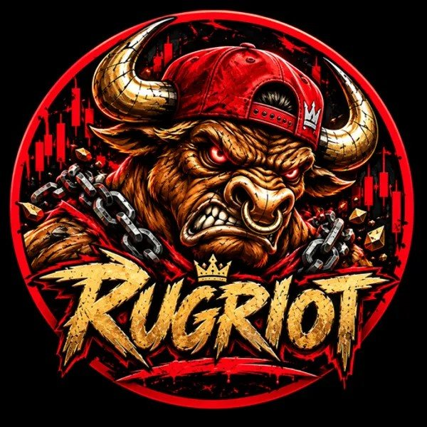

# RUGRIOT RUG HUNTERS - INVESTIGATION REPORT #005

### Ansem.tips (TIPANSEM) - FINAL MASTER - All Data Verified

> **BOUNTY SUBMISSION - TRAINING MATERIAL - FOR RUGRIOT SCAN DATABASE - EXAMPLE #005**  
> **Public blockchain data only • No harassment • No private personal info • No unsupported accusations**

---

## 🔍 Project Information

- **Project Name:** Ansem.tips (TIPANSEM)
- **Contract Address (FULL):** `B5YTUMqSnwzztWHWmzAzHApeRy6cuGEx49Bidt4kuH8w`
- **Network:** Solana - Token 2022 Program
- **Token Program:** `TokenzQdBNbLqP5VEhdkAS6EPFLC1PHnBqCXEpPxuEb`
- **Creator / Deployer:** `7Kajnz63rpBWYJkKJh69fbRuYtdiP3p6vzrBEm89xJU9`
- **Funder:** `ZPhALZcwXS2K5TmZ1z7LHF5Xp3p4rYyjJurD8gTA6wW`
- **Launch:** 12:41:48 Aug 20, 2026 UTC
- **Market:** MC $26.1K | Liquidity $17.7K | ATH $464K | Holders 715-720 | Transfers 110,724 | Volume $5.34M | Fees 142.8 SOL

## 🔗 Official Links
- Solscan Token: https://solscan.io/token/B5YTUMqSnwzztWHWmzAzHApeRy6cuGEx49Bidt4kuH8w#activities
- Dexscreener: https://dexscreener.com/solana/B5YTUMqSnwzztWHWmzAzHApeRy6cuGEx49Bidt4kuH8w
- Bubblemaps: https://v2.bubblemaps.io/map?address=B5YTUMqSnwzztWHWmzAzHApeRy6cuGEx49Bidt4kuH8w&chain=solana
- Pump.fun Logo Source: https://pump.fun/coin/EWuKfiF8mQFo4YWtKbALzyFtYMhxePjs1HJ4eCG9pump

## 📝 Transaction Signatures (FULL)
- Funding Tx FULL: TLe5DhGhnEWE2t2BYxJBfZptjGGHbzrosdPsu45CKhx3vpjPnsNGG1QmAEu3FZcrFFB2TppoucKR83p98pvtHVA
- Create Tx FULL: 3aSxqUGnP2R2skRmeKstQbBDUcixCwLsxGNtJrPYmZ15oudY9W9XgVxKP8jcEDNro64s5oR5Py1KEDMpCx5qeQUh

## 🫧 Cluster Investigation - 8 Clusters REVISED FINAL

**Cluster 1 REVISED:** 6Gfahmxqn1VfJE1rZ3JsDZdztUKMc4F8bjR9pfu1XhWZ - 17.38% Cluster Supply - Supernode - 4M Transfers - $193.92 IN from 23 addr - #188 - $9,441.37 Total Value
**Cluster 2 REVISED:** J1a5MQ...cVEr - 15.30% Cluster Supply - Magic node - 9 Transfers - Combined 1+2 = 32.68% supply concentration
**Cluster 3:** CGwB9y5hM3cAmeBRHKKqE8nvehAsq9Uz5sAsyVyD2i9D - 0.99% - $532.27 IN / $530.39 OUT - 14 Transfers
**Cluster 4:** 5ZR2krRkBvPPnSvCbGtRoBPgmjitK7zUSTRbBS5UZRjN - 0.15% - 1.47M - $38.94 - Cluster 0.52%
**Cluster 5:** 6k82nHJMHW5teRV3mYNArBgZtnpPeigVRhAwAidq9inP - 0.25% - $25.82 IN / $49.29 OUT - 1K Transfers
**Cluster 6:** ESVXppSTPpGPeMDzmNc3VvufNNTuGjq8KmEdx5URy213
**Cluster 7:** AFKEtnCiDQrG3XJPc9dAyHi9ruTTCRWnSJeVRYvPgqp7 - 0.07% - $1.53 IN / $13.35K OUT - 4K Transfers
**Cluster 8:** 8uCjADmDkJGCJtFKmf5MtKEut4KVgqBnLfBpy88WCUED - 0.05% - $186.15 IN / $102.72 OUT - 339 Transfers

## 🚀 Live Demo
- **GitHub Pages:** https://oxSouluna.github.io/RUGRIOT-RUG-HUNTERS/
- **This is FINAL MASTER - Logo & Title Revised - Content Unchanged**

## 🏆 Bounty Theme
WHAT WE WANT: facts, links, wallet evidence, transaction signatures, and a concise explanation.
CLEANER MARKETS STRONGER TRADERS NO MORE RUGS
RUGRIOT • RUG HUNTERS • TRAINING MATERIAL — EXAMPLE #005

## ⚠️ Important Note
Public blockchain data only. No harassment, no private personal info. All links verifiable. For RUGRIOT Scan database.
